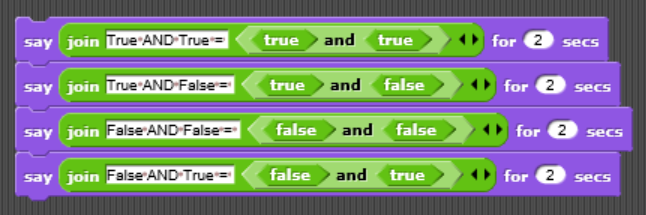

[Teacher Curriculum Map]({{ '/teacher-map/' | relative_url }}) · [Student Lesson 2.02]({{ '/student/lesson-2-02/' | relative_url }}) · [Original slides]({{ '/docs/lesson_plans/units/2_unit/slidedecks/Intro%20Python%202.02%20TEALS.pptx' | relative_url }})

> Historical TEALS lesson. Review outdated tools and external links before teaching.

# Lesson 2.02: Booleans & Expressions

## Learning Objectives

Students will be able to...

* Define and identify: **boolean, expression, composition, True, False**
* Evaluate a boolean expression
* Compose boolean expressions using `and`, `or`, `not`, `<`, `>`, and `==`

## Materials/Preparation

* [Do Now]
* [Lab - Can I or Can't I?] ([printable lab document]) ([editable lab document])

* [Associated Readings 2.2](https://github.com/aspiece/2nd-semester-introduction-to-computer-science/blob/master/_docs/lesson_plans/units/2_unit/02_lesson/../../../../readings.md#22)
* Read through the do now, lesson, and lab so that you are familiar with the requirements and can assist students.

## Pacing Guide

| **Duration**   | **Description** |
| ---------- | ----------- |
| 5 Minutes  | Do Now      |
| 10 Minutes | Lesson      |
| 35 Minutes | Lab         |
| 5 Minutes | Debrief  |

## Instructor's Notes

### 1. Do Now

* Project the Do Now on the board
* circulate around the class to check that students are working and understand the instructions.

### 2. Lesson

#### Discussion

* After 5 minutes of students working on the Do Now, ask students to recall what a boolean is and how they used booleans in Snap!
* Ask students what values they saw in part 1 of the Do Now (answer should be `True` or `False`)

#### Instruction

* **Boolean expression**: is an expression that evaluates to either true or false.
* Ask Students about the difference between `=` and `==`.
* = is for assignment of value
* == builds a boolean expression and is a way to compare two values
* Remind students of boolean expressions in Snap!

  

  

* Ask the students to recall what `and`, `or` and `not` did.
* Give students additional time to finish completing part 2 of the Do Now, if needed.
* Have a student write up the expression they used to update the `can_get_license` code.

#### Poll students -

* how many boolean expressions are used?
  * Answers here may vary depending on the students' code.

#### Instruction Part 2

* Define **composition**: Using an expression as part of a larger expression, or a statement as part of a larger statement. You can use parentheses to compose expressions as well.
* Parentheses: In Snap! to compose many expressions they were nested together by simply putting blocks one after another. However, in Python if you want certain things to be evaluated together, use parentheses.

### 3. Lab

* Evaluate expressions with `and`, `or`, and `not`
* Given written out rules, students will convert them into Boolean expressions.
* Create a large expression using variables that describes you.

### 4. Debrief

* Check student progress and completion of the lab, wrap up by taking any final questions.

## Accommodation/Differentiation

If students are moving quickly, use this opportunity to go over truth tables (or ask them to research De Morgan's Law)

### Convert the following SNAP Truth Table program into Python

   

## Forum discussion

[Lesson 2.02: Booleans & Expressions (TEALS Discourse Account Required)](https://forums.tealsk12.org/c/2nd-semester-unit-2/lesson-2-02-booleans-expressions)

[Do Now]:https://github.com/aspiece/2nd-semester-introduction-to-computer-science/blob/master/_docs/lesson_plans/units/2_unit/02_lesson/do_now.md
[Lab - Can I or Can't I?]:https://github.com/aspiece/2nd-semester-introduction-to-computer-science/blob/master/_docs/lesson_plans/units/2_unit/02_lesson/lab.md
[printable lab document]: https://github.com/aspiece/2nd-semester-introduction-to-computer-science/blob/master/_docs/lesson_plans/units/2_unit/02_lesson/lab.pdf
[editable lab document]: https://github.com/aspiece/2nd-semester-introduction-to-computer-science/blob/master/_docs/lesson_plans/units/2_unit/02_lesson/lab.docx
